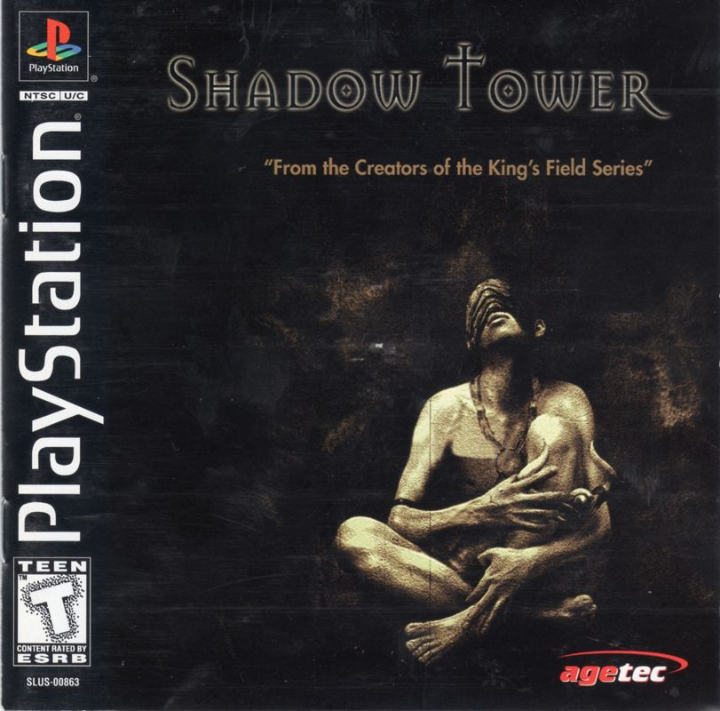

# ReShadowTower

[](https://github.com/JFryy/reshadowtower/actions/workflows/tests.yml)
[](https://github.com/JFryy/reshadowtower/actions/workflows/release.yml)
[](https://github.com/JFryy/reshadowtower/releases/latest)
[](https://github.com/JFryy/reshadowtower/releases)

[](LICENSE)



An experimental Shadow Tower recompilation for Linux and Windows x64, with mouse
and right-stick look, WASD, upscaled rendering, and sharper texture filtering.
Watch the [gameplay demo](https://www.reddit.com/r/shadowtower/comments/1wkzy54/shadow_tower_native_psx_recomp_demo/).

You need your own **Shadow Tower (USA), SLUS-00863** BIN/CUE dump. A dump with the
[UNDUB v1.0 patch](https://archive.org/details/shadow_tower_undub_patch) also works.
No BIOS needed.

## Install

Download the Linux AppImage or Windows installer from the
[releases page](https://github.com/JFryy/reshadowtower/releases).

- **Linux:** `chmod +x ReShadowTower-*.AppImage`, then run it.
- **Windows:** run the `*-setup.exe` installer, then open ReShadowTower from the Start menu.

On first launch, select your disc dump. The game is then built locally with the
bundled tools. Keep the disc files where they are. OpenGL 3.3 is required.

## Build from source

Requires Git, Python 3.11+, CMake 3.20+, Ninja, pkg-config, GCC/G++ with C++20,
and OpenGL development libraries. SDL3 3.4+ is used if installed, otherwise downloaded.

On Arch Linux:

```bash
sudo pacman -Syu --needed base-devel git python cmake ninja pkgconf sdl3 libglvnd
```

Windows source builds use [MSYS2 MINGW64](https://www.msys2.org/) and are unverified.

Put your dump in `disc/` as `Shadow Tower (USA).bin` and `Shadow Tower (USA).cue`,
then:

```bash
git clone https://github.com/JFryy/reshadowtower.git
cd reshadowtower
./scripts/build.sh
./scripts/run.sh
```

The first build fetches the pinned framework sources, so it needs internet access.

## Controls

| Action | Input |
| --- | --- |
| Move | W / S |
| Strafe | A / D |
| Look | Mouse or right stick |
| Attack | Left click or F |
| Shield | Hold right click or Z |
| Interact / confirm | E or X |
| Inventory / back | C |
| Main menu / equipment | Tab |
| Menu navigation | WASD or arrows |
| Pause | Enter |
| Release mouse / cancel | Escape |
| Fullscreen | Alt+Enter |
| Save states | F7 |

Click during gameplay to capture the mouse. The first click won't attack.
Use E or X to confirm menus, not Enter. Equip a shield before using it.
Controllers use the original digital-pad controls, plus right-stick look.

Sensitivity is set in the launcher. For source builds, use
`SHADOWTOWER_MOUSE_SENSITIVITY=0.75 ./scripts/run.sh`.

## Saves

Save at the game's headstones. Memory cards (`card1.mcd`, `card2.mcd`) are in:

- **Linux:** `~/.local/share/reshadowtower/saves` (or `$XDG_DATA_HOME/reshadowtower/saves`)
- **Windows:** `%LOCALAPPDATA%\ReShadowTower\saves`
- **Source build:** `saves/`

Back up saves with the game closed, and don't run two copies at once. Save states
(F7, then S to save, L to load) may break between builds, so keep normal saves too.

## Update

Back up your saves, then install the new release. Source builds:
`git pull --ff-only && ./scripts/build.sh`.

## Problems and contributing

Open an issue with your OS, GPU, `git rev-parse --short HEAD`, and the first error.
See [CONTRIBUTING.md](CONTRIBUTING.md) for tests (which also need PyOpenGL) and pull requests. Never share disc
dumps, generated code, or saves.

## License and credits

This unofficial FromSoftware fan project uses:

- [PSXRecomp](https://github.com/mstan/psxrecomp), under its
  [PolyForm Noncommercial license](https://github.com/mstan/psxrecomp/blob/ed55299be34710a90fc080484a83e8634bd41fa9/LICENSE).
  Its noncommercial restrictions still apply to the framework and combined runtime.
- [OpenBIOS](https://github.com/mstan/psxrecomp/blob/ed55299be34710a90fc080484a83e8634bd41fa9/bios/OpenBIOS.LICENSE),
  under MIT and its accompanying third-party notices.
